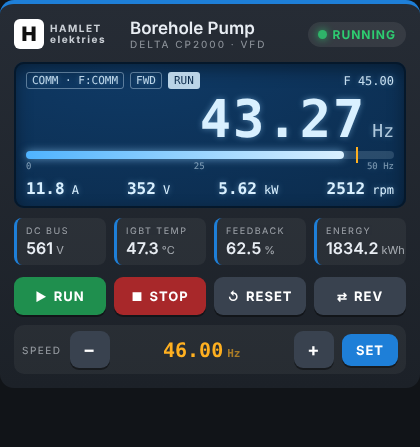

# Delta CP2000 VFD Card

A Home Assistant dashboard card for **Delta CP2000** variable frequency drives — by **Hamlet Elektries**.



**What it shows**

- Big LCD-style output frequency (Hz) with a speed bar and the setpoint marker
- Run state (RUNNING / STOPPED / STANDBY / FAULT / OFFLINE), direction, and control source (COMM / LOCAL)
- Output current, voltage, power, motor rpm, DC bus voltage, IGBT temperature, PID feedback (pressure), energy
- Fault banner with the fault code **and what it means** (e.g. `uC — Under-current (possible dry run)`)
- "NO COMMS" warning when the RS-485 link drops

**What it controls** (optional)

- RUN / STOP / RESET
- Speed setpoint: − / + then **SET**
- FWD / REV (off by default, for pumps)
- RUN and RESET need a **second tap** to confirm (STOP never asks)

Tap any value to open its history.

---

## 1. Install the card (HACS)

1. HACS → ⋮ → **Custom repositories**
2. Repository: `https://github.com/wesselswynand2-prog/delta-cp2000-card` — Type: **Dashboard**
3. Find **Delta CP2000 VFD Card** → **Download** → reload the browser

Updates you push to GitHub (as a new release) show up in every client's HACS.

## 2. Connect the drive (Modbus)

Copy [`examples/cp2000_modbus_package.yaml`](examples/cp2000_modbus_package.yaml) to `/config/packages/cp2000_vfd.yaml`, change the port (or gateway IP) and restart Home Assistant.

### Drive parameters

| Parameter | Set to | Why |
|---|---|---|
| 09-00 | 1 | Modbus address (= `slave`) |
| 09-01 | 9.6 | Baud rate (= `baudrate: 9600`) |
| 09-04 | 12 | 8,N,1 RTU |
| 09-03 | 0.0 (or 5.0) | Comm time-out; set >0 if the drive must trip on lost comms |
| 00-20 | 1 = RS-485 | Only if HA sets the speed |
| 00-21 | 2 = RS-485 | Only if HA starts/stops the drive |

**Monitor only?** Leave 00-20 / 00-21 on terminals/keypad and set `show_controls: false`.

### Wiring

RS-485 on the CP2000 control terminals **SG+ / SG-** → USB-RS485 adapter on the HA box (or an RS-485/Ethernet gateway). Twisted pair, 120 Ω termination at both ends of the bus.

## 3. Add the card

Add card → search **Delta CP2000** (visual editor works), or YAML:

```yaml
type: custom:delta-cp2000-card
name: Borehole Pump
max_frequency: 50
entities:
  status: sensor.vfd_status_word
  fault: sensor.vfd_fault_code
  frequency_command: sensor.vfd_frequency_command
  output_frequency: sensor.vfd_output_frequency
  output_current: sensor.vfd_output_current
  output_voltage: sensor.vfd_output_voltage
  dc_bus_voltage: sensor.vfd_dc_bus_voltage
  output_power: sensor.vfd_output_power
  motor_speed: sensor.vfd_motor_speed
  igbt_temperature: sensor.vfd_igbt_temperature
control:
  hub: vfd
  slave: 1
```

### Options

| Option | Default | Description |
|---|---|---|
| `name` | `VFD` | Card title |
| `logo` | – | Image URL, e.g. `/local/hamlet-logo.png` (file in `/config/www/`) |
| `brand` | `HAMLET elektries` | Text shown when no logo is set |
| `min_frequency` / `max_frequency` | 0 / 50 | Speed bar range and setpoint limits (Hz) |
| `step` | 0.5 | Hz per − / + tap |
| `entities.*` | – | Sensors (only `output_frequency` is required; `status` strongly recommended) |
| `control.hub` / `control.slave` | – / 1 | Modbus hub name and drive address — enables control buttons |
| `control.run_entity` / `stop_entity` / `reset_entity` | – | Use your own button/script instead of writing Modbus directly |
| `control.setpoint_entity` | – | Use a `number` / `input_number` for the setpoint instead |
| `show_controls` | `true` | Show buttons |
| `allow_reverse` | `false` | Show FWD/REV button |
| `confirm_actions` | `true` | Tap twice for RUN / RESET / direction |

Accent colour follows the theme variable `--hamlet-accent` (default blue).

## Registers used

| Address | Dec | R/W | Meaning |
|---|---|---|---|
| 2000H | 8192 | W | Command: 1 = STOP, 2 = RUN, 0x10 = FWD, 0x20 = REV |
| 2001H | 8193 | W | Frequency command (Hz × 100) |
| 2002H | 8194 | W | 2 = fault reset |
| 2100H | 8448 | R | Fault code (low byte), warning (high byte) |
| 2101H | 8449 | R | Status word (bits 0-1 run state, 3-4 direction, 8-10 command source) |
| 2102H–2106H | 8450–8454 | R | F cmd, output Hz, current, DC bus, output V |
| 2206H–220EH | 8710–8718 | R | kW, rpm, PID feedback, IGBT temp |

> Check the output current and power scaling against the keypad on first install — on larger frames Delta changes the decimal places.

## Safety

Starting a pump/motor remotely can be dangerous. Make sure site isolation, dry-run protection and local stop are in place before enabling remote control.

MIT licence © Hamlet Elektries
